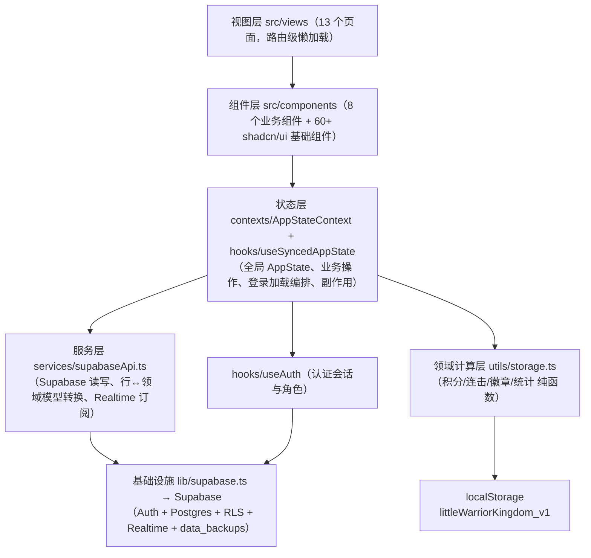

# Code Wiki · 小勇士积分王国（little-warrior-kingdom）

> 版本：v2.2.0 ｜ 文档生成日期：2026-11-04
> 面向 6~12 岁儿童的作业任务管理应用：游戏化积分 / 连击 / 徽章激励，家长配置作业库与审核兑换，Supabase 云端同步 + 本地存储双模式。

---

## 目录

1. [项目概述](#1-项目概述)
2. [技术栈与依赖](#2-技术栈与依赖)
3. [整体架构](#3-整体架构)
4. [目录结构](#4-目录结构)
5. [核心模块详解](#5-核心模块详解)
   - 5.1 [应用入口与路由](#51-应用入口与路由)
   - 5.2 [认证模块 useAuth](#52-认证模块-useauthtsx)
   - 5.3 [全局状态 AppStateContext + useSyncedAppState](#53-全局状态-appstatecontext--usesyncedappstate)
   - 5.4 [数据访问层 supabaseApi](#54-数据访问层-servicesupabaseapits)
   - 5.5 [本地存储与业务计算 utils/storage.ts](#55-本地存储与业务计算-utilspstoragets)
   - 5.6 [辅助 Hooks 与工具库](#56-辅助-hooks-与工具库)
6. [视图层（页面）](#6-视图层srcviews)
7. [组件层](#7-组件层)
8. [数据库设计（Supabase）](#8-数据库设计supabase)
9. [关键业务流程](#9-关键业务流程)
10. [项目运行方式](#10-项目运行方式)
11. [开发约定与质量门禁](#11-开发约定与质量门禁)

---

## 1. 项目概述

| 项 | 说明 |
|---|---|
| 产品定位 | 儿童作业任务管理（游戏化激励） |
| 核心玩法 | 完成任务得积分 → 积分兑换奖品（家长审核）→ 连击/徽章成就体系 |
| 双角色体系 | **家长**：配置作业库/奖品库、创建孩子账号、手动调分、审核兑换、数据管理；**孩子**：每日打卡、兑换奖品、查看成就 |
| 数据模式 | Supabase 云端（Auth + Postgres + RLS + Realtime）为主，未配置时自动降级为浏览器 localStorage 本地模式 |
| 部署形态 | Vite SPA + PWA（可安装、离线缓存、本地通知） |

---

## 2. 技术栈与依赖

### 2.1 运行时依赖（package.json）

| 类别 | 技术 | 版本 | 用途 |
|---|---|---|---|
| 前端框架 | react / react-dom | ^19.2 | UI 框架 |
| 路由 | react-router-dom | ^7.18 | SPA 路由 |
| 语言 | typescript | ~5.9（strict） | 类型系统 |
| 构建 | vite | ^7.2 | 开发服务器与打包 |
| UI 组件 | @radix-ui/*（30+ 包）+ shadcn/ui 约定 | - | 无头组件基座 |
| 样式 | tailwindcss + tailwindcss-animate + tailwind-merge + clsx + class-variance-authority | 3.4 | 原子化 CSS + 设计 Token |
| 表单 | react-hook-form + @hookform/resolvers + zod | - | 表单与校验 |
| 动画 | framer-motion | ^12 | 页面过渡/微交互动画 |
| 图表 | recharts | ^2.15 | 成长趋势图 |
| 后端 | @supabase/supabase-js | ^2.94 | Auth / DB / Realtime |
| 图标 | lucide-react | - | 线性图标 |
| 通知 | sonner | - | Toast |
| 其他 | date-fns、cmdk、vaul、embla-carousel、react-day-picker、input-otp 等 | - | shadcn/ui 组件配套 |

### 2.2 开发依赖

- **vitest + @vitest/ui + jsdom**：单元测试
- **eslint 9（flat config）+ typescript-eslint + eslint-plugin-react-hooks/react-refresh**：代码检查
- **postcss + autoprefixer**：CSS 后处理
- **@vitejs/plugin-react**：React Fast Refresh

### 2.3 环境依赖

- Node.js ≥ 20（CI 使用 22 LTS）
- pnpm ≥ 9（推荐 11，锁定唯一包管理器）
- Supabase 项目（免费版即可）

---

## 3. 整体架构

应用为典型的「React 分层 + BaaS」单页架构，自上而下分为五层：



**架构要点**

1. **单一全局状态源**：`useSyncedAppState` 是唯一的状态编排中心，通过 Context 下发，消除了 20+ 个回调 prop drilling（[AppStateContext.tsx](file:///f:/AI-Center/homework-main/src/contexts/AppStateContext.tsx)）。
2. **状态/数据访问分离**：Supabase 读写与行→模型转换全部下沉到 [supabaseApi.ts](file:///f:/AI-Center/homework-main/src/services/supabaseApi.ts)（不依赖 React，可独立测试），hook 只保留状态编排与副作用。
3. **双写同步策略**：每次状态变更 → 立即写 localStorage → 2 秒防抖自动备份到云端 `data_backups` 表；关键写操作（插入/更新）同时直写对应独立表。
4. **前端权威积分**：`totalPoints` 由前端 `calculateTotalPoints` 派生重算并校准，数据库触发器仅作历史兜底。
5. **ID 一致性原则**：所有 insert 显式携带前端 `crypto.randomUUID()` 生成的 id，保证本地 state 与云端主键一致（详见 [关键业务流程](#9-关键业务流程) 的「双轨 id 教训」）。
6. **RLS 行级安全**：孩子只能操作自己的数据，家长凭 `is_parent()` 可读写孩子数据，全部安全约束在数据库层完成。

---

## 4. 目录结构

```
homework-main/
├── index.html                    # SPA 入口 HTML（zh-CN、PWA meta、manifest 挂载）
├── package.json / pnpm-*.yaml    # 依赖与 pnpm workspace 配置
├── vite.config.ts                # Vite 配置（@ 别名 → ./src）
├── vitest.config.ts              # 单测配置（node 环境，匹配 src/**/*.test.ts）
├── tsconfig{,.app,.node}.json    # TS project references（app strict 模式）
├── tailwind.config.js            # shadcn 语义色 + 设计 Token 双轨映射
├── eslint.config.js              # flat config，no-explicit-any = error
├── .env / .env.example           # VITE_SUPABASE_URL / VITE_SUPABASE_ANON_KEY
├── public/                       # PWA 资源：manifest.webmanifest、sw.js、icons/
├── docs/                         # CODE_WIKI、CHANGELOG、design-system
├── sql/                          # 幂等数据库脚本（按阶段增量）
├── supabase/migrations/          # Supabase 官方迁移（基线 schema + updated_at 触发器）
├── scripts/gen_pwa_icons.py      # PWA 图标生成脚本
└── src/
    ├── main.tsx                  # 应用入口（StrictMode + SW 注册）
    ├── App.tsx                   # 根组件：Provider 嵌套 + 路由表 + 底部导航
    ├── index.css / App.css       # Tailwind 入口与全局样式
    ├── styles/tokens.css         # 设计系统 CSS 变量层（6 组色板/圆角/阴影/字号）
    ├── types/
    │   ├── index.ts              # 领域模型（AppState、Task、Reward、Redemption…）
    │   └── database.ts           # Supabase 数据库类型（Table/Row/Insert/RPC）
    ├── lib/
    │   ├── supabase.ts           # Supabase 客户端单例（PKCE、会话持久化）
    │   └── utils.ts              # cn() 类名合并工具
    ├── constants/icons.ts        # TASK/REWARD/BADGE 三组图标常量
    ├── contexts/AppStateContext.tsx  # 全局状态 Provider + useAppState
    ├── hooks/
    │   ├── useAuth.tsx           # 认证 Context（邮箱/用户名/手机号/RPC 建子账号）
    │   ├── useSyncedAppState.ts  # ★ 核心状态同步 Hook（~1430 行）
    │   ├── useSupabaseData.ts    # useProfile（资料 CRUD，insert 兜底）
    │   ├── useDataBackup.ts      # data_backups 表 CRUD + autoBackup
    │   ├── useReminder.ts        # PWA 本地作业提醒（30s 轮询）
    │   └── use-mobile.ts         # useIsMobile（768px 断点）
    ├── services/supabaseApi.ts   # ★ 数据访问层（读写/转换/Realtime 订阅）
    ├── utils/
    │   ├── storage.ts            # ★ localStorage + 积分/连击/徽章/统计纯函数
    │   ├── date.ts               # 本地时区日期工具（防 UTC 时区陷阱）
    │   ├── sound.ts              # Web Audio 合成音效（成功/积分/徽章/兑换）
    │   └── __tests__/storage.test.ts  # 23 个单测用例
    ├── components/               # 8 个业务组件 + ui/（60+ shadcn 组件）
    └── views/                    # 13 个页面视图（命名导出，路由处 lazy 包装）
```

---

## 5. 核心模块详解

### 5.1 应用入口与路由

#### [main.tsx](file:///f:/AI-Center/homework-main/src/main.tsx)

- `StrictMode` 挂载 `<App />`；引入 `index.css` 与 `styles/tokens.css`（设计 Token 变量层）。
- 生产环境注册 Service Worker（`/sw.js`），启用 PWA 离线缓存。

#### [App.tsx](file:///f:/AI-Center/homework-main/src/App.tsx)

- **Provider 嵌套**（:189-199）：`BrowserRouter → AuthProvider → AppStateProvider → AppContent`。
- **路由表**（:40-70）：12 条路由全部 `lazy()` 按需加载（视图为命名导出，映射为 default），`Suspense` 旋转加载态 + `PageTransition`（framer-motion 淡入平移）过渡：

| 路径 | 视图 | 路径 | 视图 |
|---|---|---|---|
| `/` | Home 孩子首页 | `/profile/points` | PointManagement 积分管理 |
| `/tasks` | Tasks 作业管理 | `/profile/children` | Children 我的孩子 |
| `/rewards` | Rewards 奖品兑换 | `/profile/badges` | Badges 徽章管理 |
| `/achievements` | Achievements 成就 | `/parent` | ParentDashboard 家长控制台 |
| `/settings` | Settings 设置 | `/privacy` | Privacy 隐私政策 |
| `/profile` | Profile 个人中心 | `/reset-password` | ResetPassword（绕过认证守卫）|
| `*` | → 重定向 `/` | | |

- **认证守卫**（:109-115）：`loading` 显示全屏加载；未登录且已配置 Supabase 时渲染 `<Auth>`（`/reset-password` 除外）。
- **全局挂载**：底部 5 Tab 导航（首页/作业/奖品/成就/我的，:125-133）、`BadgeUnlockModal` 徽章解锁弹窗、`OnboardingModal` 首登引导（localStorage `littleWarriorKingdom_onboarded` 标记）、`Toaster`。
- **提醒副作用**（:78）：登录后调用 `useReminder(state, remindEnabled, remindTime)` 启动本地通知轮询。

---

### 5.2 认证模块 [useAuth.tsx](file:///f:/AI-Center/homework-main/src/hooks/useAuth.tsx)

React Context 形式的认证中心，包装 `supabase.auth`。

| 成员 | 位置 | 说明 |
|---|---|---|
| `user / session / loading / isConfigured` | :34-39 | 会话状态；`isConfigured` 检测环境变量，未配置时应用降级本地模式 |
| `role / isParent / isChild` | :37, :201-202 | 登录后从 `profiles.role` 加载（[loadRole :42-57](file:///f:/AI-Center/homework-main/src/hooks/useAuth.tsx#L42-L57)），失败回退注册元数据 |
| `signIn(email, password)` | :89-96 | 标准邮箱密码登录 |
| `signInWithUsername(username, password)` | :99-112 | 先 RPC `get_email_by_username` 反查邮箱，再走标准密码登录 |
| `signUp(email, password, metadata)` | :135-151 | 注册，metadata 携带 username/role（默认 child） |
| `createChildAccount(username, password, parentId)` | :119-133 | **RPC `create_child_account`** 直插 auth.users + profiles（bcrypt 哈希、内部生成占位邮箱），绕过 signUp 邮件限流 |
| `sendPhoneOtp / verifyPhoneOtp` | :159-172 | 手机号验证码登录（需 Supabase Phone provider） |
| `resetPassword / updatePassword / updateProfile` | :174-193 | 密码重置（重定向 `/reset-password`，PKCE）、改密、改资料 |
| 会话监听 | :59-87 | `getSession` 初始化 + `onAuthStateChange` 订阅，状态变化自动刷新 role |

---

### 5.3 全局状态 AppStateContext + useSyncedAppState

#### [AppStateContext.tsx](file:///f:/AI-Center/homework-main/src/contexts/AppStateContext.tsx)（28 行）

- `AppStateProvider`：调用 `useSyncedAppState()` 并下发给整棵组件树。
- `useAppState()`：消费入口，未包裹 Provider 时抛错。

#### [useSyncedAppState.ts](file:///f:/AI-Center/homework-main/src/hooks/useSyncedAppState.ts)（★ 核心，~1430 行）

职责：**状态管理 + 登录加载流程编排 + 本地持久化/防抖云备份 + Realtime 订阅 + 副作用（音效/徽章）**。

**数据加载三级回退**（:94-158，登录后执行一次 `hasSyncedOnLogin` 门控）：

1. `fetchAllUserData` 拉取 11 张独立表 → 有数据则 `buildStateFromDb` 转换加载，并自动做云端备份；
2. 独立表为空 → 读 `data_backups` 最新快照恢复；
3. 备份也为空 → 若本地 localStorage 有数据，`syncLocalStateToDb` 全量上传（本地→云端初始迁移）。

**同步与持久化**：

- 积分一致性兜底（:83-91）：`dailyRecords/pointAdjustments/redemptions` 变化时派生重算 `totalPoints` 校准。
- 状态变更 → `saveState` 写 localStorage → **2 秒防抖** `autoBackup` 云备份（:161-188）。
- Realtime 订阅（:1351-1368）：`subscribeToChanges` 监听 tasks/daily_records/point_adjustments/三张分类表/redemptions 变化 → 全量 `refreshData()`；profiles 变化 → 直接同步 `totalPoints`。旧订阅先清理再重建。

**业务操作 API（按域分组，均 useCallback + 先云端后本地）**：

| 域 | 方法 |
|---|---|
| 任务 | `addTask`（显式携带本地 id 插入云端 :276-292）、`editTask`、`deleteTask`（软删除 + 联动清理今日记录 :305-329） |
| 三级分类 | `add/edit/delete{Primary,Secondary,Tertiary}Category`（删除一级时级联清空子分类并解绑任务 :362-390） |
| 今日清单 | `addTaskToToday`、`addTertiaryCategoryToToday`、`addTemporaryTaskToToday`（临时任务不入作业库 :547-589）、`generateTodayTasks`（按重复规则一键生成，去重，返回新增数 :592-630）、`removeTaskFromToday`（已完成则回退积分）、`toggleTaskCompletion`（勾选→加分+音效+徽章检查 :675-727）、`completeAllTasks` |
| 奖品与兑换 | `add/edit/deleteReward`、`redeemReward`（额度=可用积分；**云端插入失败阻断本地提交** :877-919）、`approveRedemption / rejectRedemption / fulfillRedemption`（审核状态机，云端 count=0 时回滚并全量刷新 :922-1024）、`deleteRedemption` |
| 积分调整 | `adjustPoints`（家长加减分，reason 必填，正分触发徽章检查）、`editPointAdjustment`、`deletePointAdjustment`（均联动重算总分 + 云端同步 + 备份） |
| 补签卡 | `buyMakeupCard`（20 分/张，走积分流水保审计链 :1198-1234）、`useMakeupCard`（补昨天达成，防重复 :1237-1263） |
| 自定义徽章 | `add/edit/deleteCustomBadge`（+ 删除时清理 `badges` 表 `custom:<id>` 解锁记录） |
| 设置与数据 | `toggleSound`、`updateReminder`、`exportAppData/importAppData`（JSON）、`resetAll/resetToday`（**重置前强制云备份**）、`refreshData`（手动全量刷新） |
| 派生 | `availablePoints`（总积分−冻结积分）、`getTodayRecord`、`getStats`（连击/分类统计/完成总数/今日进度）、`newlyUnlockedBadges + clearNewlyUnlockedBadges` |

**副作用编排**：`unlockBadges`（:193-230）——内置徽章 + 自定义徽章双检查 → 播放徽章音效 → 标记 `unlockedAt` → 记录 `newlyUnlockedBadges`（驱动解锁弹窗）→ 异步 `upsertBadge` / `upsertCustomBadgeUnlock` 云同步。

---

### 5.4 数据访问层 [services/supabaseApi.ts](file:///f:/AI-Center/homework-main/src/services/supabaseApi.ts)

**不依赖 React 的纯数据访问层**（~706 行），封装所有 Supabase 表读写、Realtime 订阅与「数据库行 ↔ 领域模型」转换。

- **行类型**（:30-40）：从 `Database['public']['Tables'][...]['Row']` 派生 11 个 Row 类型。
- **行→模型转换器**（:45-124）：`toPrimaryCategory / toSecondaryCategory / toTertiaryCategory / toTask / toDailyRecord / toReward / toRedemption / toPointAdjustment / toCustomBadge`——处理 snake_case→camelCase、时间戳→毫秒、空值兜底（图标默认 emoji、`status` 缺省视为 approved 兼容旧数据）。
- **查询**：
  - `fetchAllUserData(userId)`（:143-183）：`Promise.all` 并行拉取 11 张表 + profile。
  - `hasIndependentData(data)`（:186-197）：判断独立表是否有数据（决定加载路径）。
  - `fetchChildren(parentId)` / `linkChildToParent` / `fetchChildData(childId)`（:204-263）：多孩子支持，家长读孩子数据依赖 RLS 放行。
  - `buildStateFromDb(data)`（:266-299）：由行数据构建完整 AppState，徽章保留默认定义并合并解锁时间；自定义徽章解锁复用 `badges` 表（`badge_type = 'custom:<id>'`）。
- **写入**（:308-539）：与业务一一对应的 `insertXxx / updateXxx / deleteXxx` 封装，**全部显式携带前端生成的 id**。特殊逻辑：
  - `insertRedemption`（:428-467）：错误码分级处理——`42703`（缺 status 列）给出执行 `now-phase-trust-fix.sql` 的修复指引；`23503`（外键违规）降级为 `reward_id: null` 重插。
  - `updateRedemptionStatus`（:472-480）：返回受影响行数 `count`，0 表示云端无此记录（双轨 id 遗留数据），调用方可触发全量刷新。
  - `softDeleteTask`：任务删除为 `is_active=false` 软删除。
  - `upsertDailyRecord`：按 `onConflict: 'user_id,date'` 幂等更新当日记录。
- **备份**：`fetchLatestBackup`（:550-561）、`syncLocalStateToDb`（:564-629，本地全量 upsert 上传）。
- **Realtime**：`subscribeToChanges(userId, handlers)`（:644-706）——6 组 channel 订阅（tasks / daily_records / profiles / point_adjustments / 三张分类表 / redemptions），均带 `user_id=eq.<id>` 过滤；返回退订函数数组。

---

### 5.5 本地存储与业务计算 [utils/storage.ts](file:///f:/AI-Center/homework-main/src/utils/storage.ts)

localStorage 键 `littleWarriorKingdom_v1`；纯函数领域计算层（配 23 个单测）。

**持久化**

| 函数 | 说明 |
|---|---|
| `loadState` / `saveState` | 读取时与初始态合并、字段缺省兜底（含旧数据补签卡字段兼容） |
| `exportData` / `importData` | JSON 序列化/反序列化（导入同样做初始态合并） |
| `resetAllData` / `resetTodayRecord` | 全量重置 / 删除今日记录 |
| `getTodayRecord` / `getOrCreateTodayRecord` | 获取或构造今日记录 |
| `MAKEUP_CARD_PRICE = 20` | 补签卡单价 |

**核心算法**

| 函数 | 位置 | 说明 |
|---|---|---|
| `isDayAchieved` | :133-142 | 当天完成率 ≥ 阈值（默认 0.8，可配）或已用补签卡 → 达成 |
| `calculateStreak` | :144-174 | 达成日集合（达成日 ∪ 补签日）倒序排列；最新记录必须是今/昨否则清零；相邻日期差 1 天连续计数 |
| `calculateTotalPoints` | :355-391 | **总分 = Σ每日记录积分 + Σ积分调整 − Σ兑换消耗（仅 approved/fulfilled；pending 冻结、rejected 退还；旧数据无 status 视为已扣）**，下限钳 0 |
| `getPendingRedemptionPoints` / `getAvailablePoints` | :394-403 | 冻结积分 / 可用积分（孩子兑换额度判断） |
| `checkAndUnlockBadges` | :285-333 | 12 种内置徽章解锁判定（连击 3/7/15、分类 20/30/15 次、积分 50/100/200/500、百次任务、首次兑换） |
| `checkCustomBadges` | :336-353 | 自定义徽章（tasks/points/streak 条件）解锁判定 |
| `getCategoryStats` / `getPrimaryCategoryStats` | :176-277 | 按四级分类/一二级分类聚合完成次数 |
| `getPointsTrend(state, days)` | :410-423 | 近 N 天积分趋势（本地时区补零） |
| `getWeeklyReport` | :459-486 | 本周 vs 上周完成数/完成率/积分 |
| `isRepeatDueOn` / `getTertiaryDueToday` | :437-449 | 重复规则判定（none/daily/weekly + weekdays），驱动「一键生成今日清单」 |

**内置徽章定义** `DEFAULT_BADGES`（:6-19）：12 种（🔥 连击×3、⚽📚🎨 分类大师、💰💎👑🏆 积分、🎁 首次兑换、⭐ 任务大师）。

---

### 5.6 辅助 Hooks 与工具库

| 文件 | 导出 | 说明 |
|---|---|---|
| [useDataBackup.ts](file:///f:/AI-Center/homework-main/src/hooks/useDataBackup.ts) | `useDataBackup` | `data_backups` 表 CRUD：`createBackup`（含设备信息/文件大小元数据）、`fetchBackups`、`restoreBackup`、`deleteBackup`、`autoBackup`（静默失败不打扰用户）；被 useSyncedAppState 内部消费 |
| [useReminder.ts](file:///f:/AI-Center/homework-main/src/hooks/useReminder.ts) | `requestNotificationPermission`、`useReminder` | 30 秒轮询：到达设定时间、当天未提醒过、且有未完成任务 → 发浏览器 Notification；`remindedDates` 防重 |
| [useSupabaseData.ts](file:///f:/AI-Center/homework-main/src/hooks/useSupabaseData.ts) | `useProfile` | profiles 资料读写（`fetchProfile` + username/avatar/phone 更新），三个 update 均「失败则 insert 兜底」 |
| [use-mobile.ts](file:///f:/AI-Center/homework-main/src/hooks/use-mobile.ts) | `useIsMobile` | 768px matchMedia 断点 |
| [date.ts](file:///f:/AI-Center/homework-main/src/utils/date.ts) | `getTodayStr / getYesterdayStr / formatDate / daysBetween` | **本地时区日期收口**，规避 `toISOString()` 在 GMT+8 凌晨的 UTC 错位（项目规约：禁止直接 `toISOString().split('T')[0]`） |
| [sound.ts](file:///f:/AI-Center/homework-main/src/utils/sound.ts) | `playSuccessSound / playPointSound / playBadgeSound / playRedeemSound` | Web Audio 振荡器合成 4 种音效（无音频文件），懒初始化 AudioContext，`enabled` 开关 |
| [icons.ts](file:///f:/AI-Center/homework-main/src/constants/icons.ts) | `TASK_ICONS / REWARD_ICONS / BADGE_ICONS` | 任务/奖品/徽章三组 emoji 图标常量 |

---

## 6. 视图层（src/views）

13 个页面均为**命名导出**（App.tsx 处 lazy 包装），业务逻辑通过 `useAppState()` / `useAuth()` 消费全局能力。

| 视图 | 位置 | 职责与关键逻辑 | 消费的状态/方法 |
|---|---|---|---|
| [Home.tsx](file:///f:/AI-Center/homework-main/src/views/Home.tsx) | :15-365 | 孩子首页：总积分、今日进度、今日清单、快捷入口；完成打卡按任务定义弹积分 toast（:40-62）；全勤彩花庆祝（:317-363）；任务渲染「无 taskDef → 三级分类回退」双分支 | `state, toggleTaskCompletion, completeAllTasks, getStats` |
| [Tasks.tsx](file:///f:/AI-Center/homework-main/src/views/Tasks.tsx) | :41-880 | 作业管理双 Tab（今日清单/分类作业库）；三级分类 CRUD + 重复规则（`buildRepeatRule` :126-133）+ `handleSubmit` 按 6 种 dialogType 分支（:135-195）+ 临时任务对话框；**编辑/删除按钮由 `isParent` 门控** | `isParent` + useAppState 15 项方法 |
| [Rewards.tsx](file:///f:/AI-Center/homework-main/src/views/Rewards.tsx) | :28-570 | 奖品墙 + 兑换审核流；`handleRedeem` 处理 insufficient/no-user/cloud-error 三种失败（:110-134）；pending→approved→fulfilled/rejected 状态徽标（:21-26）；家长审核按钮组（:288-342） | `availablePoints`、奖品 CRUD、兑换四操作 |
| [Achievements.tsx](file:///f:/AI-Center/homework-main/src/views/Achievements.tsx) | :14-417 | 成就页：连击与补签卡（可购/可用判定 :31-36）、Recharts 趋势图、周报（`getNextGoal` 阶梯目标 :57-62）、分类统计、徽章墙 | `state, getStats, buyMakeupCard, useMakeupCard, availablePoints` |
| [Auth.tsx](file:///f:/AI-Center/homework-main/src/views/Auth.tsx) | :14-449 | 登录/注册/忘记密码三合一；邮箱与用户名双模式切换（:29-30）；注册选角色（:392-420）；未配置 Supabase 降级提示（:107-137） | `signIn, signInWithUsername, signUp, resetPassword, isConfigured` |
| [Profile.tsx](file:///f:/AI-Center/homework-main/src/views/Profile.tsx) | :36-378 | 个人中心：资料编辑、3 数据卡、**角色化功能入口**（`actionTiles` 按 `isParent` 过滤 :141-146）、登出 | `state` + `useAuth` + `useProfile` |
| [PointManagement.tsx](file:///f:/AI-Center/homework-main/src/views/PointManagement.tsx) | :36-671 | 家长手动加减分 + 调整流水管理；**家长顶部孩子切换器**（0 孩子空态 / 1 孩子自动选中 / 多孩子 chip），统计与流水按所选孩子读取；扣分按孩子总分截断，编辑校验 `孩子总分 - 原值 + 新值 >= 0`；写操作走 `adjust/update/delete_child_point_adjustment` RPC；孩子端只读自己的 `state.pointAdjustments` | `fetchChildrenResult, fetchChildData, adjustChildPointsRpc, updateChildPointAdjustmentRpc, deleteChildPointAdjustmentRpc` |
| [Children.tsx](file:///f:/AI-Center/homework-main/src/views/Children.tsx) | :14-295 | 家长管理孩子档案：RPC 建子账号（:53-58）+ 只读数据面板（`fetchChildData` 结果拼成伪 AppState 复用纯函数计算 :104-122）；非家长锁定 | 直连 `supabaseApi` + `createChildAccount` |
| [ParentDashboard.tsx](file:///f:/AI-Center/homework-main/src/views/ParentDashboard.tsx) | :16-175 | 家长控制台：4 项数据总览 + 待审兑换就地审核（pending 过滤排序 :27-29）+ 6 快捷入口 | `approveRedemption, rejectRedemption, state` |
| [Badges.tsx](file:///f:/AI-Center/homework-main/src/views/Badges.tsx) | :23-268 | 家长自定义徽章 CRUD（条件 tasks/points/streak）；新建/编辑复用同一表单（:43-69） | `add/edit/deleteCustomBadge` |
| [Settings.tsx](file:///f:/AI-Center/homework-main/src/views/Settings.tsx) | :17-444 | 音效/提醒开关、JSON 导出（Blob 下载 :41-52）/导入（FileReader :54-75）、重置今日/全部（**确认词「确认重置」+ 内部先云备份** :83-97）；数据管理仅家长 | `toggleSound, updateReminder, export/importAppData, resetAll, resetToday` |
| [Privacy.tsx](file:///f:/AI-Center/homework-main/src/views/Privacy.tsx) | :10-118 | 静态隐私政策 5 节（儿童数据保护、家长同意、数据权利） | 无 |
| [ResetPassword.tsx](file:///f:/AI-Center/homework-main/src/views/ResetPassword.tsx) | :17-157 | PKCE 密码重置落地页；状态机 checking/ready/done/invalid（:23），检查 session 与 URL code | `updatePassword` |

**权限模型**：所有配置类操作（分类/奖品 CRUD、兑换审核、手动调分、徽章管理、导入导出、重置）由 `isParent` 门控；孩子端仅可勾任务、加临时任务、兑换、购买/使用补签卡。

---

## 7. 组件层

### 业务组件（src/components/）

| 组件 | 职责 |
|---|---|
| [TaskItem.tsx](file:///f:/AI-Center/homework-main/src/components/TaskItem.tsx) | 任务行：三级分类徽章 + 可选 onToggle/onDelete/onAddToToday 回调 |
| [RewardCard.tsx](file:///f:/AI-Center/homework-main/src/components/RewardCard.tsx) | 奖品卡：`canAfford` 控制禁用 + 锁定遮罩 |
| [PointsDisplay.tsx](file:///f:/AI-Center/homework-main/src/components/PointsDisplay.tsx) | 积分数字，值变化 300ms 弹跳动画 |
| [ProgressBar.tsx](file:///f:/AI-Center/homework-main/src/components/ProgressBar.tsx) | 进度条，progress 钳制 0-100 |
| [BadgeDisplay.tsx](file:///f:/AI-Center/homework-main/src/components/BadgeDisplay.tsx) | 徽章卡：解锁金光动画 / 未解锁灰度 / NEW 角标 |
| [BadgeUnlockModal.tsx](file:///f:/AI-Center/homework-main/src/components/BadgeUnlockModal.tsx) | 解锁弹层：按 id 数组从 allBadges 过滤展示（App 全局挂载） |
| [OnboardingModal.tsx](file:///f:/AI-Center/homework-main/src/components/OnboardingModal.tsx) | 首登 4 步引导，按 `role` 切换家长/孩子文案 |
| [IconPicker.tsx](file:///f:/AI-Center/homework-main/src/components/IconPicker.tsx) | 通用 emoji 图标网格选择器 |

### UI 基础组件（src/components/ui/，60+ 个）

shadcn/ui 约定生成，基于 Radix UI 无头组件 + CVA 变体 + `cn()`（[lib/utils.ts](file:///f:/AI-Center/homework-main/src/lib/utils.ts)，clsx + tailwind-merge）合并类名。含 button/dialog/tabs/select/dropdown/alert-dialog/sonner（Toast）/chart（Recharts 封装）/sidebar 等。

---

## 8. 数据库设计（Supabase）

### 8.1 表清单（12 张）

| 表 | 用途 / 关键字段 | RLS 要点 | 引入阶段 |
|---|---|---|---|
| `profiles` | 用户档案一表双角色：`role`(parent/child)、`parent_id` 亲子关联、`total_points`、`username`、`phone`；id 关联 auth.users | SELECT：本人或家长（`is_parent_of`）；UPDATE/INSERT 仅本人 | 基线 |
| `tasks` | 作业库：`base_points`、三级分类外键、`is_temporary`（临时任务）、`is_active`（软删除） | 本人 CRUD | 基线 + Next |
| `daily_records` | 每日记录：`tasks` JSONB 快照、`total_points`；`UNIQUE(user_id, date)` | 本人 CRUD | 基线 |
| `rewards` | 奖品库：`points`、`category`(娱乐/实物/特权/其他) | 本人可读 + 家长可写 | 基线 + Now |
| `redemptions` | 兑换记录：`status`(pending/approved/fulfilled/rejected)、`reward_name/points` 快照、`reward_id` ON DELETE SET NULL | 孩子 INSERT、家长 UPDATE/DELETE | 基线 + Now |
| `badges` | 已解锁徽章，`UNIQUE(user_id, badge_type)`；自定义徽章解锁复用（`badge_type='custom:<id>'`） | 本人 | 基线 |
| `point_adjustments` | 手动加减分流水：`points`(±)、`reason` 必填 | 本人 CRUD（直接 RLS）；家长写孩子走 `child-points-binding.sql` 的 3 个 RPC（`is_parent_of` 校验） | 基线 + Now + v2.2.0 |
| `primary/secondary/tertiary_categories` | 三级分类；tertiary 含 `default_points`、`repeat_rule` JSONB | 本人；Next 阶段追加 9 条家长读策略 | 基线 + Next |
| `custom_badges` | 家长自定义徽章：`condition_type`(tasks/points/streak)、`condition_value` | 本人可读 + 家长可写 | Later |
| `data_backups` | 云端备份快照：`backup_data` JSONB、`device_info`、`file_size` | 本人 SELECT/INSERT/DELETE | **仅 migrations 基线**（full-schema.sql 无此表） |

### 8.2 函数 / RPC / 触发器

| 名称 | 作用 |
|---|---|
| `is_parent_of(uuid)` / `is_parent(uid)` | RLS 辅助函数（SECURITY DEFINER 防 RLS 递归），判断亲子关系 |
| `get_email_by_username(text)` | 用户名→邮箱反查（用户名登录），anon 可调，精确匹配防枚举 |
| `create_child_account(text,text,uuid)` | 家长代建子账号：启用 pgcrypto，bcrypt 哈希密码，内部生成 `kid<uuid>@example.com` 占位邮箱，一次 RPC 建 auth.users + profiles 并绑 `parent_id`（绕过 GoTrue 邮件校验/限流） |
| `update_child_profile` / `reset_child_password` / `unbind_child` / `bind_existing_child` | 家长管理孩子：编辑昵称/头像、重置密码（旧登录失效）、解绑（保留数据）、绑定已有孩子（校验邮箱存在且未绑定） |
| `approve_redemption(uuid)` | 家长一次确认兑换：校验亲子关系，`pending → fulfilled` 并正式扣分 |
| `dispatch_to_child(child_id, table, items)` / `delete_child_template(child_id, table, item_id)` | 数据下发复制（作业三级分类/奖品/自定义徽章，名称幂等）与孩子模板删除（表名白名单 + 行属主校验） |
| `adjust_child_points(uuid, int, text)` / `update_child_point_adjustment(uuid, int, text)` / `delete_child_point_adjustment(uuid)` | 家长手动调分写孩子账号：`is_parent_of` 校验，单事务写 `point_adjustments` 并同步 `profiles.total_points`（编辑按差值、删除回滚） |
| `handle_new_user` + 触发器 `on_auth_user_created` | 注册自动建 profile + 初始化默认分类 |
| `calculate_user_total_points` / `update_user_total_points` + 3 个积分触发器 | 数据库侧积分兜底计算（=任务+调整−兑换，钳 0）；**以前端计算为准** |
| `set_updated_at`（8 个触发器） | 统一维护 `updated_at`（migrations 第二个文件） |
| 视图 `user_category_hierarchy` | 三级分类层级查询视图 |
| 索引 | 约 20 个，以 `user_id` 为主 |

### 8.3 SQL 脚本执行顺序

全部幂等（`IF NOT EXISTS` / `OR REPLACE`），在 Supabase SQL Editor 依次执行：

```text
① sql/full-schema.sql                        # 基线：10 张业务表 + RLS + 积分触发器
   （或 supabase/migrations/20260814120000_initial_schema.sql，含 data_backups）
② sql/now-phase-trust-fix.sql                # P0：redemptions.status 审核状态机 + is_parent() + 家长 RLS 重建
③ sql/next-phase-growth-retention.sql        # P1：is_temporary / repeat_rule / 多孩子家长读策略
④ sql/later-phase-scale-compliance.sql       # P2：custom_badges 表 + RLS
⑤ sql/username-login.sql                     # get_email_by_username RPC
⑥ sql/create-child-account.sql               # create_child_account RPC
⑦ sql/parent-controls.sql                    # 10 表家长读策略 + 孩子管理 7 个 RPC
⑧ sql/child-points-binding.sql               # 家长调分写孩子账号 3 个 RPC
```

**注意：`full-schema.sql` 不含 data_backups/status/is_temporary/repeat_rule/custom_badges，新库必须补跑 ②③④；家长审核与孩子管理需补跑 ⑦，家长手动调分需补跑 ⑧。** 脚本索引与一次性脚本见 [sql/README.md](../sql/README.md)。

存量库排障矩阵（症状 → 处置）：

| 症状 | 处置 |
|------|------|
| 兑换报 `Could not find the 'status' column of 'redemptions'` | 先跑 `fix-redemption-status-only.sql` 急救（仅补列 + NOTIFY 刷新缓存），再补跑 ② |
| 添加作业报 `column tertiary_categories.repeat_rule does not exist` (42703) | 跑 `fix-tertiary-repeat-rule.sql`（最小化补列），或补跑 ③ |
| 需将全部存量兑换记录归一为「兑换成功」 | 跑 `migrate-redemption-all-fulfilled.sql`（注意：pending 也会转为正式扣分口径） |
| 兑换正常但家长无法审核 | 跑 ②（`is_parent()` + redemptions 家长策略） |
| 想用临时任务/重复规则/多孩子 | 跑 ③ |
| 想用自定义徽章 | 跑 ④ |
| 家长看不到孩子数据 / 无法审批兑换 / 无法编辑解绑孩子 | 跑 ⑦ |
| 家长手动加减分没有记到孩子账号 / RPC 报函数不存在 | 跑 ⑧ |

运维脚本：`query-child-accounts.sql`（子账号核查 5 段查询）。

---

## 9. 关键业务流程

### 9.1 登录数据加载（三级回退）

```text
登录成功（useAuth）
  └→ useSyncedAppState 检测 user + !hasSyncedOnLogin
       ├─ ① 独立表有数据 → buildStateFromDb → setState + saveState + 自动云备份
       ├─ ② 独立表空 → data_backups 最新快照 → 恢复 + 重算 totalPoints
       └─ ③ 均为空但本地有数据 → syncLocalStateToDb 全量上传（本地→云端迁移）
```

### 9.2 积分体系

```text
totalPoints = Σ dailyRecords.totalPoints        # 作业完成
            + Σ pointAdjustments.points          # 家长手动调整（含购买补签卡 -20）
            − Σ redemptions.points (仅 approved/fulfilled)   # 兑换消耗
availablePoints = totalPoints − Σ pending 兑换    # 冻结额度不可再用
```
前端每次相关变更后派生重算校准（useSyncedAppState :83-91），并异步 `updateProfileTotalPoints` 写回 profiles 表。

> 家长端积分管理（v2.2.0）：页面顶部切换所选孩子，孩子数据经 `fetchChildData` 读取（RLS 家长读策略放行），统计用 `calculateTotalPoints(buildStateFromDb(childData))`；加减分/编辑/删除不再写家长自己的账号，而是调用 `adjust/update/delete_child_point_adjustment`，由 RPC 在同一事务内写孩子的 `point_adjustments` 并同步 `profiles.total_points`。

### 9.3 兑换审核状态机

```text
孩子 redeemReward ──→ pending（积分冻结，不扣分）
                        ├─ 家长一次「确认兑换」──→ fulfilled（兑换成功，正式扣分）
                        └─ 家长 reject  ──→ rejected（冻结退还）
```

> v2.1.4（2026-10-30）起兑换为**一次确认**流程：家长确认即 `fulfilled`，无需二次「标记已兑现」；`approved` 仅为历史数据兼容保留在枚举中，积分口径与 `fulfilled` 相同（均按已扣分）。历史存量可用 `sql/migrate-redemption-all-fulfilled.sql` 归一。

云端插入/更新失败的处理：插入失败**阻断本地提交**（防止次日重载记录消失）；更新返回 `count=0` 时回滚并全量 `refreshData()`。

### 9.4 连击与徽章

- **达成日** = 当天完成率 ≥ `streakThreshold`（默认 0.8）的日期 ∪ 补签卡补签的日期。
- **连击**：最新达成日必须是今天或昨天，否则清零；按日历日连续计数。
- **补签卡**：20 积分/张（走积分流水），可补昨天为达成；每日期限用一次。
- **徽章**：每次完成/调分后触发 `checkAndUnlockBadges` + `checkCustomBadges` → 新解锁进入 `newlyUnlockedBadges` → 全局弹窗庆祝 → 异步云同步。

### 9.5 「双轨 id」教训（重要架构决策）

早期 insert 不携带前端 id，由数据库生成主键，导致「本地 id ≠ 云端 id」：
- update/delete 按本地 id 匹配云端 0 行，**静默失败**；
- `redemptions.reward_id` 外键指向不存在的云端奖品 id，兑换插入失败，**次日记录整体丢失**。

根治方案（[supabaseApi.ts :302-307 注释](file:///f:/AI-Center/homework-main/src/services/supabaseApi.ts#L302-L307)）：所有 insert **显式携带前端 `crypto.randomUUID()`**；审核接口返回受影响行数，为 0 时触发全量刷新自愈。

### 9.6 多端实时同步

写操作直写独立表 → Supabase Realtime 推送 postgres_changes（按 `user_id` 过滤）→ 另一端（如家长审核后孩子端）自动 `refreshData()` 全量刷新；profiles 的 `total_points` 变化则轻量直更。

---

## 10. 项目运行方式

### 10.1 环境要求

- Node.js ≥ 20（推荐 22 LTS）、pnpm ≥ 9（推荐 11；Corepack 启用：`corepack enable`）

### 10.2 安装与配置

```bash
git clone <repository-url>
cd homework-main
pnpm install
pnpm exec tsc -b          # 验证依赖完整性（类型检查通过）

cp .env.example .env      # 配置环境变量
```

`.env` 内容：

```env
VITE_SUPABASE_URL=https://your-project.supabase.co
VITE_SUPABASE_ANON_KEY=your-anon-key
```

> 未配置时应用仍可启动，自动降级为 localStorage 本地模式（无登录、无云同步）。

### 10.3 初始化数据库

按 [8.3 节](#83-sql-脚本执行顺序) 顺序在 Supabase SQL Editor 执行脚本（详见 [SUPABASE_SETUP.md](file:///f:/AI-Center/homework-main/SUPABASE_SETUP.md)）。

### 10.4 常用命令

```bash
pnpm dev            # 开发服务器 http://localhost:5173
pnpm build          # 类型检查 + 生产构建（tsc -b && vite build）
pnpm preview        # 预览生产构建
pnpm lint           # ESLint 检查
pnpm test           # Vitest 单元测试（storage.test.ts，23 用例）
pnpm exec tsc -b    # 仅 TypeScript 类型检查
```

### 10.5 CI 流水线（[.github/workflows/ci.yml](file:///f:/AI-Center/homework-main/.github/workflows/ci.yml)）

push main / PR 触发：ubuntu + pnpm 11 + Node 22 → install → **lint（`continue-on-error`，暂不阻塞）→ build（含 tsc -b，强制）→ test（强制）**，超时 15 分钟。

### 10.6 PWA

- [public/manifest.webmanifest](file:///f:/AI-Center/homework-main/public/manifest.webmanifest)：standalone、portrait、zh-CN，图标 192/512（含 maskable）。
- [public/sw.js](file:///f:/AI-Center/homework-main/public/sw.js)：缓存 `little-warrior-v1`；`/auth/ /rest/ /realtime/` 网络优先不缓存动态数据；导航网络优先、离线回退 index.html；静态资源缓存优先；notificationclick 聚焦窗口。
- 图标由 [scripts/gen_pwa_icons.py](file:///f:/AI-Center/homework-main/scripts/gen_pwa_icons.py) 生成。

---

## 11. 开发约定与质量门禁

| 约定 | 说明 |
|---|---|
| 包管理器 | 仅 pnpm，禁止提交 package-lock.json / yarn.lock |
| 样式 | 使用设计系统 Token（[tokens.css](file:///f:/AI-Center/homework-main/src/styles/tokens.css) 6 组色板 + Tailwind 语义类），禁止硬编码色值 |
| ID 生成 | 统一 `crypto.randomUUID()`，禁止 `Date.now().toString()` |
| 日期处理 | 统一走 [utils/date.ts](file:///f:/AI-Center/homework-main/src/utils/date.ts)（本地时区），禁止 `toISOString().split('T')[0]`（UTC 时区陷阱） |
| 类型 | ESLint `no-explicit-any: error` 强制门禁；数据访问层零 any |
| 日志 | 生产代码禁止 `console.log`，错误处理可用 `console.error` |
| SQL | 存放 sql/，自包含可重复执行；**禁止提交关闭 RLS 的脚本** |
| 组件规范 | 新组件放 src/components/，页面放 src/views/；视图命名导出，路由处 lazy 包装 |
| 提交信息 | Conventional Commits（feat/fix/docs/refactor…） |
| 提交前自检 | `pnpm lint` → `pnpm exec tsc -b` → `pnpm test` → `pnpm build` 全部通过 |

---

## 附录 · 相关文档索引

> 2026-10-30 文档收敛：`docs/` 由 5 份合并为 3 份——《项目总览》并入本文档（§8.3 排障矩阵等），《项目历史》并入 CHANGELOG 附录。
> 2026-11-04 新增 `docs/README.md` 与 `sql/README.md` 作为文档/脚本导航索引（不新增正文文档）。

- [README.md](file:///f:/AI-Center/homework-main/README.md) — 功能特性、使用示例、贡献指南
- [docs/README.md](file:///f:/AI-Center/homework-main/docs/README.md) — 文档导航与维护约定
- [sql/README.md](file:///f:/AI-Center/homework-main/sql/README.md) — SQL 脚本分类、执行顺序与运维脚本
- [docs/design-system.md](file:///f:/AI-Center/homework-main/docs/design-system.md) — v2.0 亮色乐园设计系统规范
- [docs/CHANGELOG.md](file:///f:/AI-Center/homework-main/docs/CHANGELOG.md) — 版本演进 + 开发批次详细记录（附录）
- [SUPABASE_SETUP.md](file:///f:/AI-Center/homework-main/SUPABASE_SETUP.md) — Supabase 配置步骤
